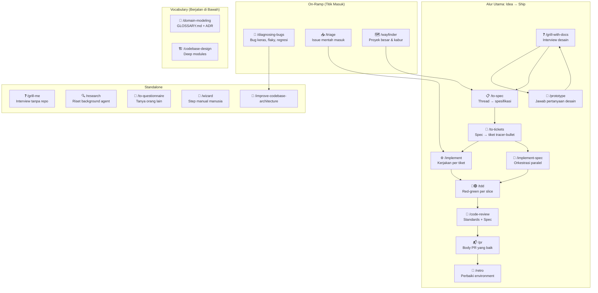

# Tutorial: Memaksimalkan Skill Matt Pocock

Panduan lengkap untuk memanfaatkan sistem skill engineering Matt Pocock di Antigravity.

---

## Apa Ini?

Skill Matt Pocock adalah **seperangkat alur kerja terstruktur** yang mengubah AI coding assistant dari "aku kasih perintah, dia coding" menjadi **proses engineering yang disiplin**: ide diuji dulu, spek ditulis, tiket dipecah, kode ditulis test-first, dan di-review sebelum merge.

Bayangkan kamu punya senior engineer yang:
- Menolak langsung coding sebelum paham masalahnya
- Selalu bikin test dulu baru implementasi
- Review kode di dua axis sekaligus
- Tahu kapan harus prototipe dan kapan langsung build

Itulah yang skill ini berikan.

---

## Peta Besar: Seluruh Skill dalam Satu Gambar



---

## Alur Kerja yang Paling Sering Dipakai

### Skenario 1: "Aku mau bikin fitur baru"

Ini **main flow**, jalur yang paling sering kamu lewati.

#### Langkah 1: Grill dulu, jangan langsung coding

```
Kamu: /grill-with-docs Aku mau bikin halaman manajemen inventaris bahan untuk EverGlade
```

Agent akan **mewawancarai kamu habis-habisan** dalam format ronde:

> ❓ **Q1** - **Scope halaman**: Halaman terpisah atau modal di dalam 3D HUD yang sudah ada?
> ➡️ Rekomendasi: Halaman terpisah (inventaris.html), karena CRUD stok butuh tabel dan form yang tidak cocok di modal kecil.
>
> ❓ **Q2** - **Siapa pengguna utama**: Petani di lapangan (mobile) atau admin di desktop?
> ➡️ Rekomendasi: Keduanya, tapi prioritas mobile karena petani cek stok di kebun.

**Kamu jawab**, dan ronde berikutnya muncul berdasarkan jawabanmu. Ini terus sampai **semua keputusan desain terjawab**.

Hasil: `GLOSSARY.md` terupdate, ADR tercatat jika ada keputusan yang sulit dibalik.

#### Langkah 2: Kalau ada yang harus dilihat, prototipe

```
Kamu: /prototype Aku mau lihat gimana UI tabel stok bahan yang baik di mobile
```

Agent bikin **throwaway code** — bukan produksi, tapi bisa dibuka di browser. Kamu lihat, putuskan, buang kodenya, bawa keputusannya kembali.

#### Langkah 3: Kalau multi-sesi, pecah jadi tiket

```
Kamu: /to-spec
```

Agent mengubah seluruh hasil grilling jadi **spesifikasi tertulis**.

```
Kamu: /to-tickets
```

Spec dipecah jadi **tiket tracer-bullet** dengan blocking edges (tiket A harus selesai sebelum tiket B).

#### Langkah 4: Implementasi

Dua cara:

| Cara | Kapan |
|---|---|
| `/implement` per tiket | Kamu mau kontrol manual, satu per satu |
| `/implement-spec` | Kamu mau agent orkestrasi sendiri, paralel |

Di dalam implementasi, agent menjalankan `/tdd`:
1. **Red**: tulis test yang gagal
2. **Green**: tulis kode seminimal mungkin agar test lewat
3. Ulangi per slice

#### Langkah 5: Review

```
Kamu: /code-review main
```

Agent review di **dua axis terpisah**:

| Axis | Pertanyaan |
|---|---|
| **Standards** | Apakah kode mengikuti coding standards repo? (+ Fowler code smells) |
| **Spec** | Apakah kode mengimplementasikan spec dengan benar? |

Dilaporkan terpisah supaya satu axis tidak menutupi yang lain.

#### Langkah 6: PR & Retro

- `/pr` otomatis dipakai agent saat bikin PR body (diagram, before/after evidence, merge danger)
- `/retro` merefleksikan sesi: apa yang bisa diperbaiki di **environment** (bukan kode), supaya build berikutnya lebih baik

---

### Skenario 2: "Ada bug yang susah"

```
Kamu: /diagnosing-bugs Checkin form submit tapi data tidak muncul di analytics
```

Agent mengikuti **6 fase diagnosis yang ketat**:

| Fase | Apa yang terjadi |
|---|---|
| 1. Feedback Loop | Agent bikin satu perintah yang **pasti gagal** di bug ini. Tidak boleh menebak sebelum loop ada. |
| 2. Reproduce + Minimise | Perkecil kasus sampai seminimal mungkin |
| 3. Hypothesise | 3–5 hipotesis terukur, diranking |
| 4. Instrument | Probe satu variabel per satu |
| 5. Fix + Regression Test | Test dulu sebelum fix |
| 6. Cleanup | Hapus semua debug log |

> [!IMPORTANT]
> Fase 1 adalah intinya. Agent **menolak menebak** sebelum punya feedback loop yang bisa dijalankan. Ini yang membedakan debugging asal-asalan vs debugging sistematis.

---

### Skenario 3: "Aku mau riset dulu"

```
Kamu: /research Apa best practice untuk inventaris management UI di aplikasi pertanian?
```

Agent meluncurkan **background agent** yang membaca sumber primer (docs resmi, source code, spec), lalu menyimpan hasil riset ke file Markdown di repo. Kamu bisa terus kerja selagi dia riset.

---

## Skill-Skill Vocabulary (Selalu Aktif di Belakang)

Dua skill ini **bukan workflow**, tapi **bahasa bersama** yang dipakai semua skill lain:

### `/domain-modeling`

Menjaga bahasa domain tetap tajam:

- Kalau kamu bilang "bahan" tapi di code ada "inventaris" dan "produk", agent akan menantang: "yang mana yang dimaksud?"
- Update `GLOSSARY.md` saat term resolved
- Catat ADR kalau ada keputusan yang hard to reverse

### `/codebase-design`

Vocabulary untuk mendesain modul yang **deep** (banyak perilaku di balik interface kecil):

| Term | Artinya |
|---|---|
| **Module** | Apapun yang punya interface dan implementasi |
| **Depth** | Leverage: berapa banyak perilaku per unit interface |
| **Seam** | Tempat di mana kamu bisa ganti perilaku tanpa edit di tempat itu |
| **Adapter** | Hal konkret yang memenuhi interface di sebuah seam |

---

## Aturan Context Hygiene

> [!WARNING]
> Ini yang paling sering diabaikan dan menyebabkan degradasi kualitas.

### Smart Zone (~150k token)

Model reasoning paling tajam dalam ~150k token pertama. Setelah itu mulai menurun.

### Aturan:

1. **Langkah 1–3 (Grill → Spec → Tickets) dalam satu context window.** Jangan compact sebelum tiket jadi.
2. **Setiap `/implement` mulai fresh.** Tiket sudah self-contained, jadi context sebelumnya bisa dibuang.
3. **`/retro` dijalankan di sesi yang sama**, sebelum clear.

### Phase Boundaries — 5 Pilihan

Di antara dua fase kerja, kamu punya 5 opsi:

| Opsi | Kapan |
|---|---|
| **Continue** | Default. Tidak ada cost. |
| **`/clear`** | Buang semua context, kalau yang lalu tidak relevan |
| **`/handoff`** | Tulis markdown portabel untuk pindah ke directory/harness/kolega lain |
| **Subagent** | Kirim task kecil ke window terpisah, dapat report balik |
| **`/compact`** | Kompres context lama, lanjut di sesi baru (default fallback) |

---

## Contoh Konkret: EverGlade

Berdasarkan analisis sebelumnya, begini cara pakai skill system untuk P0 (Inventaris Bahan):

````
Sesi 1: Desain (jangan compact sampai tiket jadi)
├── /grill-with-docs "Halaman manajemen inventaris bahan"
│   └── 3-5 ronde pertanyaan desain
│   └── GLOSSARY.md terupdate: "bahan" vs "produk" vs "inventaris"
├── /prototype (jika perlu lihat UI)
│   └── prototype/inventaris-ui branch
├── /to-spec
│   └── Spec tertulis
└── /to-tickets
    └── Tiket 1: Halaman daftar bahan (GET /api/inventaris-bahan)
    └── Tiket 2: Form tambah/edit bahan
    └── Tiket 3: Stok menipis alert
    └── Tiket 4: Tambah/kurangi stok manual

Sesi 2-5: Implementasi (satu sesi per tiket, /clear antar tiket)
├── /implement Tiket 1
│   └── /tdd (red → green per slice)
│   └── /code-review
├── /clear
├── /implement Tiket 2
│   └── ...
└── ...

Sesi 6: Retro
└── /retro
    └── "Perlu tambahkan coding standards file"
    └── "Navigation di index.html butuh refactor"
````

---

## Cheatsheet Perintah

| Perintah | Kapan Pakai | Satu Kalimat |
|---|---|---|
| `/grill-with-docs` | Mulai fitur baru (ada repo) | Interview desain, simpan ke GLOSSARY + ADR |
| `/grill-me` | Mulai fitur baru (tanpa repo) | Interview desain, stateless |
| `/prototype` | Perlu lihat/rasakan sebelum commit | Throwaway code yang menjawab pertanyaan desain |
| `/to-spec` | Setelah grilling selesai | Ubah thread jadi spec tertulis |
| `/to-tickets` | Setelah spec jadi | Pecah spec jadi tiket dengan blocking edges |
| `/implement` | Kerjakan satu tiket | TDD + code review per tiket |
| `/implement-spec` | Kerjakan semua tiket sekaligus | Orkestrasi paralel dengan subagents |
| `/tdd` | Mau build behavior test-first | Red → green loop |
| `/code-review` | Review branch/PR | Standards + Spec, dua axis terpisah |
| `/diagnosing-bugs` | Bug keras / flaky / regresi | 6 fase diagnosis disiplin |
| `/research` | Butuh riset background | Background agent baca sumber primer |
| `/prototype` | "Gimana kalau..." | Throwaway code, bukan produksi |
| `/pr` | Tulis PR body | Diagram + evidence + merge danger |
| `/retro` | Selesai build | Perbaiki environment, bukan kode |
| `/domain-modeling` | Bahasa domain kabur | Pertajam term di GLOSSARY.md |
| `/codebase-design` | Desain interface modul | Deep module vocabulary |
| `/wizard` | Step yang cuma manusia bisa | Generate bash script interaktif |
| `/ask-matt` | Bingung pakai skill yang mana | Peta ini |

---

## Setup Awal

> [!TIP]
> Jalankan `/setup-matt-pocock-skills` sekali di awal project untuk konfigurasi issue tracker, triage labels, dan doc layout yang diasumsikan skill-skill lain. Tanpa ini, beberapa skill (seperti `/code-review` axis Spec) akan mengeluh tentang missing `docs/agents/issue-tracker.md`.

---

## Prinsip Inti

1. **Fakta adalah tugas agent, keputusan adalah tugasmu.** Agent mencari info, kamu yang memutuskan.
2. **Jangan skip grilling.** Langsung coding tanpa grilling = bayar waktu 3x di debugging.
3. **Satu slice vertikal, bukan horizontal.** Jangan tulis semua test dulu lalu semua implementasi. Satu test → satu implementasi → ulangi.
4. **Feedback loop sebelum hipotesis.** Untuk bug: punya satu perintah yang gagal dulu, baru boleh menebak.
5. **Context itu mahal.** Jaga smart zone. Compact di boundary, bukan di tengah fase.
