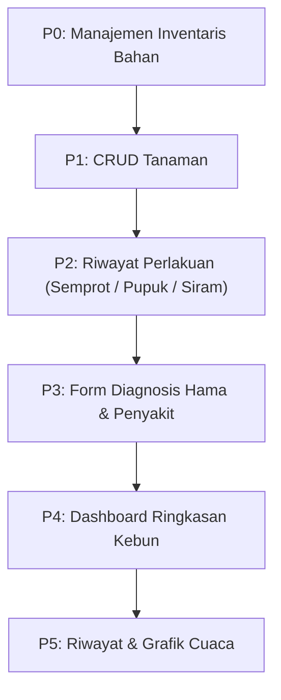

# EverGlade UI — Peta Prioritas Pengembangan

Berdasarkan survei codebase per 3 November 2026.

---

## Kondisi Saat Ini

| Lapisan | Status |
|---|---|
| **Database** | 12 tabel, schema matang (tanaman, cuaca, inventaris, log_pemeriksaan, kondisi, perlakuan, detail campuran). Satu migration `V1`. |
| **Backend API** | 13 controller, ~30 endpoint. CRUD lengkap untuk semua entitas. Service layer ada untuk `Tanaman`, `LogPemeriksaan`, `InventarisBahan`. |
| **Frontend** | **Satu file** `index.html` (4.215 baris). Dashboard 3D Three.js + glass HUD. Sudah memanggil `/api/tanaman`, `/api/log-pemeriksaan`, `/api/cuaca/current`, Open-Meteo API. |

### Yang Sudah Ada di UI

- ✅ Diorama 3D kebun + karakter penyemprot
- ✅ Kartu iklim mikro (suhu, kelembapan, live dari Open-Meteo)
- ✅ Plant Inspector modal (fase tumbuh, tinggi, status kesehatan)
- ✅ Modal Checkin (form catat pengukuran → POST `/api/log-pemeriksaan`)
- ✅ Analytics Dashboard (grafik pertumbuhan, KPI, riwayat log)
- ✅ Aksi: Semprot Kebun (batch spray)

### Yang Belum Punya UI

Ini endpoint yang sudah ada di backend **tapi belum tersentuh** oleh frontend:

| Domain | Endpoint | Tidak Ada UI |
|---|---|---|
| **Inventaris Bahan** | `/api/inventaris-bahan` (CRUD, stok menipis, tambah/kurangi stok) | ❌ Belum ada halaman manajemen stok |
| **Perlakuan Pemupukan** | `/api/perlakuan-pemupukan` | ❌ Belum ada form/riwayat pemupukan |
| **Perlakuan Penyiraman** | `/api/perlakuan-penyiraman` | ❌ Belum ada form/riwayat penyiraman |
| **Perlakuan Penyemprotan** | `/api/perlakuan-penyemprotan` | ❌ Belum ada riwayat detail penyemprotan |
| **Detail Campuran** | `/api/detail-campuran-semprot`, `/api/detail-bahan-pemupukan` | ❌ Belum ada UI tank mix |
| **Kondisi Kesehatan** | `/api/kondisi-kesehatan` | ❌ Belum ada form diagnosis hama/penyakit |
| **Kondisi Vegetatif** | `/api/kondisi-vegetatif` | ❌ Tidak terpisah di UI (masih di-embed di checkin) |
| **Kondisi Tanaman** | `/api/kondisi-tanaman` | ❌ Tidak ada overview kondisi seluruh kebun |
| **Tanaman CRUD** | `/api/tanaman` POST/PUT/DELETE/PATCH aktifkan | ❌ Belum ada UI tambah/edit/hapus tanaman |
| **Cuaca** | `/api/cuaca` GET (riwayat) | ❌ Riwayat cuaca belum bisa diakses |

---

## Rekomendasi Prioritas

Disusun berdasarkan **dampak ke pengguna harian** (petani / pengelola kebun cabai rawit).

### P0 — Manajemen Inventaris Bahan 🔴

**Mengapa pertama:** Backend punya `InventarisBahanService` yang sudah menghitung stok dan mengecek kadaluarsa. Tanpa UI ini, aksi "Semprot Kebun" dan "Pupuk Organik" yang sudah ada di 3D HUD **tidak pernah memotong stok yang benar**, dan pengguna tidak tahu sisa stok mereka.

**Scope:**
- Halaman/modal daftar bahan (nama, tipe, stok, satuan, kadaluarsa)
- Tombol tambah/edit/hapus bahan
- Indikator stok menipis (endpoint `/stok-menipis` sudah ready)
- Tambah/kurangi stok manual

### P1 — CRUD Tanaman

**Mengapa:** Saat ini UI hardcode 40 polybag (PB-01 s/d PB-40). Pengguna tidak bisa menambah tanaman baru, mengubah varietas, atau menonaktifkan yang mati. Endpoint `POST/PUT/DELETE/PATCH aktifkan` sudah ada.

**Scope:**
- Modal tambah tanaman (nama, varietas, lokasi, tanggal tanam)
- Edit & soft-delete dari plant inspector modal
- Daftar tanaman di analytics dashboard yang dinamis (bukan hardcode)

### P2 — Riwayat Perlakuan Lengkap

**Mengapa:** Setiap kali pengguna "Semprot Kebun" atau "Pupuk Organik" dari 3D, data masuk ke backend tapi **tidak bisa dilihat kembali**. Pengguna butuh riwayat: kapan terakhir semprot, campuran apa, dosis berapa.

**Scope:**
- Tab di analytics modal: Penyemprotan / Pemupukan / Penyiraman
- Detail campuran per perlakuan (bahan, dosis/L, total terpakai)
- Timeline view per tanaman

### P3 — Form Diagnosis Hama & Penyakit

**Mengapa:** `kondisi_kesehatan` punya field jenis_gangguan, nama_gejala, tingkat_keparahan, bagian_terdampak — tapi checkin form saat ini cuma dropdown "Gejala Kutu Daun/Thrips" tanpa detail. Data diagnosis yang kaya tidak bisa masuk.

**Scope:**
- Perluas checkin form: jenis gangguan, nama gejala, keparahan, bagian terdampak
- Riwayat kesehatan per tanaman di inspector modal

### P4 — Dashboard Ringkasan Kebun

**Mengapa:** Analytics modal sudah ada tapi data masih banyak hardcode. Setelah P0–P3, ada cukup data untuk ringkasan bermakna.

**Scope:**
- Peta kesehatan seluruh kebun (berapa sehat, berapa perlu perhatian, berapa kritis)
- Stok bahan yang menipis (alert)
- Jadwal perlakuan berikutnya

### P5 — Riwayat & Grafik Cuaca

**Mengapa:** Nice to have. Data cuaca sudah tersimpan via `/api/cuaca`, tapi tren historis kurang mendesak dibanding manajemen stok dan perlakuan.

---

## Catatan Arsitektur

> [!IMPORTANT]
> File `index.html` saat ini **4.215 baris** (HTML + CSS + Three.js + semua logika). Sebelum menambah fitur besar, pertimbangkan memecahnya:
> - Pisahkan JS ke file terpisah (`app.js`, `three-scene.js`, `api.js`)
> - Atau buat halaman terpisah untuk manajemen (`inventaris.html`, `tanaman.html`) yang berbagi nav
> - Alternatif: gunakan modal system yang sudah ada dan tambah tab di analytics modal

> [!TIP]
> Semua backend endpoint **sudah siap pakai**. Tidak perlu tambah migration atau entity baru untuk P0–P3. Ini murni pekerjaan frontend.

---

## Langkah Selanjutnya

Mau mulai dari mana? Pilihan:

1. **Langsung `/implement` P0** (Inventaris Bahan) — bisa jadi modal baru atau halaman terpisah
2. **`/grill-with-docs`** dulu — kalau mau diskusi lebih dalam soal UX approach (tetap single page 3D, atau split ke multi-page?)
3. **`/to-spec` → `/to-tickets`** — kalau mau pecah semua P0–P5 jadi tiket terstruktur yang bisa dikerjakan satu per satu
